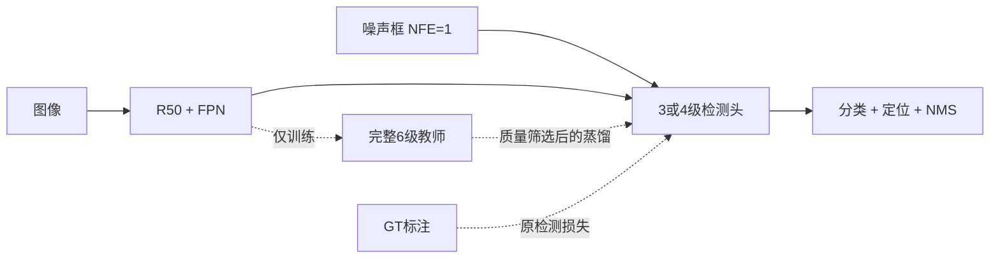

# V3 蓝图：单步扩散下的检测头压缩与定位增强

版本：2026-10-15。目标：在相同图像尺寸和评测协议下，获得比现有单步模型
更好的精度—延迟组合。初始阶段沿用 SDD 筛选，再用 PLS/WHEAT 确认。
技术来源见 [RESEARCH.md](RESEARCH.md)，实测见 [RESULTS.md](RESULTS.md)，状态见 [PROGRESS.md](PROGRESS.md)。

## 1. 重新界定问题

已经阅读 `docs/{BLUEPRINT,RESULTS,PROGRESS,ISSUES,TECH_REPORT}.md` 和 `docs/v2/`。
v1/v2 的重要结论是：现有训练条件下，求解器改善远小于延长训练的收益；
历史最佳 ckpt 上 DDIM@1=70.27、DPP@2=70.36，仅差 0.09 AP。
因此不再优先投资 EMS、EDM 或更多扩散步。

但 **NFE=1 不等于一次框回归**：`DynamicHead` 内串行执行 6 个 `RCNNHead`。
每级都做 ROIAlign、自注意力、DynamicConv、FFN、分类与回归；
还默认生成随即丢弃的 attention weights。这是 v2 没有测量的压缩轴。

成本模型改为：

`L = L_preprocess + L_backbone + sum_{n=1..NFE} sum_{h=1..H_n} L_head(P_h) + L_postprocess`

除 NFE 外记录 H、P、分辨率、精度模式和 batch。自注意力部分近似随 P² 增长，
ROI/DynamicConv 部分主要随 P 增长；不能把总头成本简化成 P²。
假如头占比 2/3，6→4 级、每级等成本的理论加速约为 1.29×；
这是成本估算，不是实测，也不能把 Windows 上的旧占比直接套到当前机器。

### 纠正旧证据的边界

- v2 用 `||x0(t)-x0(final)||` 测的是预测漂移，**不是轨迹曲率或 ODE 离散误差的直接估计**。
  检测集合无固定语义顺序，未按匹配、置信度和目标归属分解时不能判定“弯曲均来自无效框”。
- 两次训练相差约 1.4 AP 是观察到的差值，**不是估计出的训练标准差**。3 个推理 seed 也不能替代 3 个训练 seed。
- “两步永远不可能超越单步”超过了现有证据。本轮只把它视为当前任务/权重上的低优先级方向。
- 旧矩阵脚本中的 `--eval-batch` 并未实际传给 loader；各脚本和表的计时口径需分别审计。
  本轮明确使用 batch=1，不把批量时间除以 batch 冒充单图响应时间。
- `model_predictions` 没有消费 `x_self_cond`，仅打开 `self_condition` 标志不能得到有效的新模型。

## 2. 现场资产与验证边界

- 当前环境：torch 2.1.2+cu121 / detectron2 0.6；GPU1 为 RTX 3090 24GB，启动前查询为空闲。
- 历史 `output/lab/sdd.res50.bs8.long/model_final.pth` 已不存在。
  本轮使用现存 `output/lab/sdd.res50.bs8/model_final.pth`（1750 iter）的冻结权重，逐参数严格加载并记录 SHA256。
  **禁止把此权重的新结果与历史 70.27 AP 相减后宣称改造增益。**
- `output/` 指向工作区外的 `/models/hch/fastdd_output`；只读旧权重，所有新产物写入本仓库 `runs/v3/`。
- SDD train/val：1750/750 图，3932/1775 个目标，单图最多 17/15 个；
  small 目标仅 27/12 个。小目标 AP 容易大幅抖动，需同时看数量与逐目标召回，不能独立作强结论。
- 训练类别数量 117–1453，约 12.4× 不平衡；稀有类（如 Anthracnose Fruit Rot）需要单独报告。
  数据数量与标注 hash 归档在 `results/raw/v3_sdd_data_audit.json`。

## 3. 新模型路线



### A. 第一优先级：检测头深度与执行优化（已开始实现）

1. 新增 `EVAL_NUM_HEADS=0..NUM_HEADS`，0 为完整头。评测只执行前 H 级；
   保留全部参数和原始命名，旧权重严格加载。训练始终执行完整级数和原辅助监督。
2. 新增 `ATTENTION_NEED_WEIGHTS`。False 避免计算/返回无用的注意力权重；
   torch 2 可选择 SDPA 实现，但本实验**不预先声称实际使用了 FlashAttention**。
3. 初始网格：6/5/4/3 级 × no_weights，加 6 级 legacy 对照。全部 NFE=1、P=300、800/1333。
4. 选满足精度门槛的最浅出口；不能仅因为吞吐更高就宣布新默认配置成立。

### B. 精度补偿：面向浅层出口的质量筛选蒸馏（已实现初筛原型）

2026-10-11 继续：实际实现与配对训练协议见 [DISTILLATION.md](DISTILLATION.md)。
3 对短预算初筛已完成，KD 增益证据不足，未晋级。后续先稳定微调预算并独立验证 t 对齐，
判定和数值见 [RESULTS.md](RESULTS.md)。以下保留 KD 的方法设计与进一步研究条件。

教师选择同域训练的完整 6 级模型，学生为 3/4 级。先保留原 `L_focal + 5 L1 + 2 GIoU`
及每级监督，再添加轻量训练损失：

`L = L_det + lambda_cls * T² * KL_Bernoulli(sigmoid(z_teacher/T) || sigmoid(z_student/T)) + lambda_box * L_box_KD`

- Focal 分类为独立 sigmoid，蒸馏应使用 Bernoulli KL，不能直接换成互斥 softmax KL。
- 教师 `no_grad`/stop-gradient，不部署教师；初始 T=2、lambda_cls=0.5、lambda_box=1，作为待筛超参数。
- 用 GT 归属对齐 teacher/student 正匹配；只有匹配同一 GT、教师 IoU 高于学生且 ≥0.5 时传递定位。
  不直接对齐未匹配的第 i 个 proposal，也不让背景框主导归一化分母。
- 坐标按各图宽高归一化；空 GT、无合格匹配返回可求导零值。温度/阈值/归一化写入配置。
- 首先比较同一学生结构的“无 KD / 有 KD”，初始化、增强、优化器、迭代和训练 seed 一致。
  若训练仍需完整 6 级供自蒸馏，另报训练总耗时；部署仍只执行学生级数。
- 推理端已有噪声 t=999，训练 t 对齐作为后续独立因子，先不与 KD 叠加以免归因混乱。

#### T1：训练时刻对齐（已完成，未通过完整门槛）

G2 初筛未通过后，独立比较真实 H4 的 uniform / mix_tmax(p=0.5)，KD 关闭。
两臂同为600步、3对训练seed；只按预先固定的最后权重评测。通过私有 mixture RNG
和逐批 x_start/eps/输入/全局 RNG 校验保证只改变 t，默认训练行为保持原样。
门槛、随机数设计和复现入口见 [TIME_ALIGNMENT.md](TIME_ALIGNMENT.md)。
该实验不改变部署成本，不将额外训练预算的收益归于时刻对齐或架构压缩。
完整3对结果：ΔAP=+0.465，但ΔAP75=−0.160低于预设−0.1，保持uniform默认。
600步uniform H4为67.777 AP；后续Q1已补齐同预算H6（68.056 AP），H4−H6为−0.278 AP，
本轮重新计时p50低17.76%。均值接近−0.3带，但速度未达20%门槛，且只有3对训练seed；
尚未证明完整联合目标。该比较包含深度和辅助监督变化，不能拿微调H4与冻结H6作压缩因果结论。

### C. 精度增强：边界分布与质量校准（第二优先级）

面向 AP75：将每级 `bboxes_delta: D→4` 扩展为 `D→4(K+1)` 的边界/残差分布，初试 K=16。
通过积分得到坐标；保留 L1/GIoU，并添加 DFL 和深→浅分布蒸馏。

需要先解决本模型特殊接口：ROI proposal 可能不包住 GT，因此不能照搬 anchor point
必须位于框内的正 l/t/r/b 假设。支持区间应允许有符号中心残差；宽高在 log-space 建模；
统计训练集残差覆盖率，避免粗网格或截断限制 AP75。新回归层单独初始化，其他参数迁移。
先仅换最终头，再扩展多级分布残差。普通坐标蒸馏不标为已复现 GO-LSD。

面向分类—定位错位：可另加质量预测分支，目标是 detached IoU，校准分数后再 NMS；
或逐步替换为质量感知分类损失。保持 Dynamic-K 匹配不变作为对照，避免同时改匹配和损失。
先看 score-IoU 相关性、重复检测与误分类，证实存在该瓶颈再实现。

G1 离线诊断已完成，见 RESULTS：H4 在中低置信度区输出更多背景，而固定分数阈值
下GT覆盖率并未一致下降，整体 score-IoU 曲线也接近H6。优先验证背景/定位质量的
区分监督；不能把 AP 下降直接等同于定位精度退化。分布回归的复杂度需用更高IoU
匹配的独立证据支撑。NMS后重复框不多，暂不优先改NMS；早期proposal仍需另测召回。

2026-10-13启动、现已完成[Q1质量监督](QUALITY_SUPERVISION.md)：只将最后一级的二值focal替换为
带原alpha权重的quality focal，目标为detached匹配IoU；匹配代价、辅助头和部署结构不变。
同时补齐600步H6原focal对照；H4控制复用T1末步权重并重新评测，新臂逐步核验与T1的
输入/噪声/时刻/RNG/LR。三训练seed、共27次全量评测，全部审计通过。
2026-10-14汇总：quality−focal的AP−0.170、AP75−0.720，仅1/3配对AP为正，未过预设门槛。
score≥0.3时背景框均值少41个，同时正确匹配少38个、IoU0.75覆盖率少1.75个百分点；
不足以证明更好的排序，固定阈值计数也不是AP归因。保留原focal，不据此搜索更多alpha/gamma。
本轮只验证最后一级分类损失；分布回归和额外质量分支仍未实现，其有效性需独立证据。

### D. 更大提速：逐级 proposal 预算（第二优先级）

2026-10-13已完成固定P先导实验[P1](PROPOSAL_BUDGET.md)：三份T1 uniform H4权重，
P300/200/150/100、三个推理seed，共36次全量评测。小P的p50降幅仅0.50%–0.93%，
AP下降0.303–0.999，全部未通过门槛。保持P300；在此硬件与FP32协议下，减少框数
未带来实用提速，不能仅根据理论计算量推广逐级剪框。后续若重启此方向，先分段测量
可节省的实际延迟，并保留早期探索；先导实验不等于逐级裁剪或小P重训。

2026-10-14已完成[L1耗时审计](LATENCY_PROFILE.md)：三份训练seed的H4/P300、H4/P100、
H6/P300，共27组无插桩/分段计时和9组算子轨迹。H4减框的本轮平均p50降幅为4.10%，
单个推理seed配对范围−10.17%至+12.50%，不把小差值认定为稳定部署收益。
H4/P300的分段stream区间中，backbone约41%、完整head约48%，attention仅约3.7%；
这些区间含调度间隙，不能直接视为纯kernel成本或可实现加速上限。
ROI池化每图28次stream同步，P100仍28次；其中16次对应逐层nonzero、8次scalar读取、
4次copy。减框减少DynamicConv计算，却保留逐级调度和同步，不能按P²推算整体加速。

2026-10-15已完成[B1骨干FP16](BACKBONE_PRECISION.md)：18次全验证、9组逐图交错计时。
ΔAP+0.003、ΔAP75+0.014，精度条件通过；交错p50降低11.66%，未达预设15%门槛。
骨干FP16保留可选，FP32仍为默认；精度模式的提速不归因于新结构或训练增强。
后续优先利用CPU已知框数量构造池化索引、减少动态长度同步。先做数值与梯度/输出对拍，
不修改安装的Detectron2，不直接删掉数据有效性检查；是否有实际收益仍需无插桩评测。
暂不叠加减框或QFL，也不把L1诊断描述为已经实现了执行加速。

初选 schedule `300→150→100→100`，保留前两级探索，后续以质量排序压缩。
不能只按早期类别置信度 top-k：保留空间覆盖/探索份额（初试 25%），防止稀有类漏检。
需要同步 gather boxes 与 proposal_features，并保留每层目标索引；压缩后层输出不能简单 `torch.stack`。
训练采用与部署一致的 schedule，蒸馏按 GT 匹配处理变长集合。

另设 P 恒定 300/150/100 的对照，以区分“减少总 proposal”与“逐级分配”的贡献。
跨 P 实验显式生成 300 个噪声再取子集；不同形状 `randn` 即便 seed 相同也不保证配对噪声。
报告 proposal recall、每类召回和拥挤图指标。不能依据当前单图最多 17 个 GT 就断言 P=20 足够。

### E. 特征与骨干蒸馏（第三优先级）

若浅层定位/KD 后 AP 仍受语义限制，再试 DEIMv2/EdgeCrafter 路线：同域教师适应 →
紧凑骨干蒸馏 → 多尺度适配。先用训练专用教师 ROI/FPN 特征蒸馏保留现有部署结构，
再比较紧凑 ViT/HGNetv2 替换。独立引入 RT-DETRv3 风格训练辅助 dense branch。

不在第一轮叠加基础模型、更高分辨率和外部训练数据；同时保留一个公开轻量 DETR
作为长期工程参照，避免只在 DiffusionDet 家族内找局部最优。

## 4. 实验 Gate（目标，不是已获得结果）

| 阶段 | 内容 | 通过标准 | 决策 |
|---|---|---|---|
| G0 | 数值、前后向、严格加载、旧求解器回归 | 默认行为不变；浅出口=完整头对应前缀；梯度有限 | 不过则不计性能 |
| G1 | 冻结权重深度扫描，3 推理 seed | H≤4 的 AP 相对同 ckpt legacy6 ≥−0.3；p50 至少降低 20%；报告 p95 | 选部署候选或量化 KD 缺口 |
| G2 | 学生无 KD vs 有 KD，至少 3 配对训练 seed | KD 学生比无 KD 学生 ≥+0.5 AP；浅学生达到完整头 AP−0.3 | 优先走性价比最好的 H |
| G3 | 分布定位 / 质量校准，逐项消融 | 同延迟预算下 ≥+0.5 AP、AP75 提升；新增头延迟 ≤5% | 过 Gate 后才叠加 |
| G4 | 逐级 proposal 压缩 | 对原完整头 p50 ≥1.4× 加速，AP≥原基线−0.3 | 按拥挤图/稀有类否决条件筛选 |
| G5 | 最终联合模型 | 争取 ≥1.3× 加速且 ≥+0.5 AP；否则分别给出速度/精度 Pareto 点 | PLS/WHEAT 确认后推荐 |

预算：G1 15 次全验证，无训练，按冒烟估算约 10–20 分钟单卡；
G2 初筛 200–500 iter 检查损失/梯度，再采用同预算完整训练。以实测 step time 推算 GPU 小时，
不沿用 v2 已被环境/初始化问题推翻的 35 分钟训练估计。先完成低成本 Gate 再扩大实验。

## 5. 评测与防止过拟合实验选择

- 冻结权重筛选：固定 image_id 顺序，按 `(seed,image_id)` 生成噪声，消除 arm 遍历顺序影响。
  3 推理 seed 只表征随机采样敏感性，不能证明重训收益。
- AP/AP50/AP75/各类 AP，APs/m/l 附目标数；COCO 默认 maxDets=100、NMS 保持不变。
- 延迟：batch=1，FP32，TF32 关闭，CUDA 双向同步，20 图 warmup + 同一 200 图计时，报告 p50/p95。
  包括 H2D、模型预处理、backbone、head、NMS、后处理；不包括磁盘解码、CPU resize、evaluator。
  它是明确边界的模型响应时间，不是从相机采集到显示的系统总延迟。
- 在同 GPU 顺序运行各臂，奇数 seed 反转顺序，记录硬件、权重/源代码/标注 hash、配置和预测。
  FP16/BF16/TensorRT 在架构确定后另立表，避免把数值精度改变的提速算作架构收益。
- 训练正式结论：至少 3 配对训练 seed，报告配对 ΔAP；可加按图 bootstrap。
  小样本下不要把 3 次采样推理标准差当成置信区间。
- 当前 SDD val 已多次用于方案选择，因此定位为开发集。训练调参另在 train 内固定划分；
  最终用未用于选型的 PLS test（若无历史使用）或新留出集确认，不再反复用测试集调门槛。

## 6. 已落地入口

```bash
# 使用现存短训权重，绝不覆盖历史 output/。
/home/huachenghao/.conda/envs/fastdiff/bin/python scripts/v3_head_sweep.py \
  --gpu 1 --seeds 0 1 2 --out-dir runs/v3/head_sweep_new_run

# 新行为测试与旧求解器回归。
OMP_NUM_THREADS=4 /home/huachenghao/.conda/envs/fastdiff/bin/python -m pytest \
  tests/test_v3_head.py tests/test_m1_ddim.py tests/test_m1_convergence.py -q
```

实现：`diffusiondet/{config,head}.py`、`scripts/v3_head_sweep.py`；
`configs/lab/v3/sdd.res50.attention.yaml` 保留完整 6 级，仅关闭无用 attention weights；
候选配置 `configs/lab/v3/sdd.res50.head4.yaml` 只定义推理出口，**不表示已训练出 4 级学生**。
G2 已实现真实四级学生与独立冻结教师，短预算初筛已完成但未通过晋级条件。
P1固定预算先导已完成且未通过；G3的Q1质量分类监督已完成三对训练，未通过晋级门槛。
分布回归、额外质量分支、G4逐级裁剪、G5联合模型仍未实现。
L1已完成冻结模型成本审计；B1骨干FP16已实现并完成验证，未通过预设速度门槛。
ROI执行优化尚未实现，按上文独立验证。
最新实测和 Gate 判定以 RESULTS/PROGRESS 为准。
