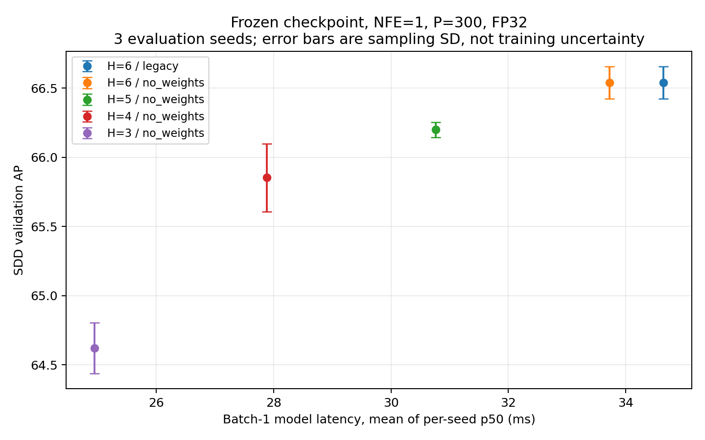
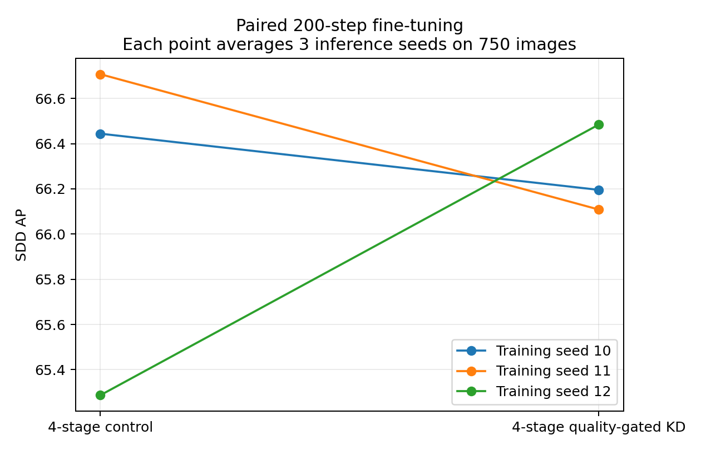
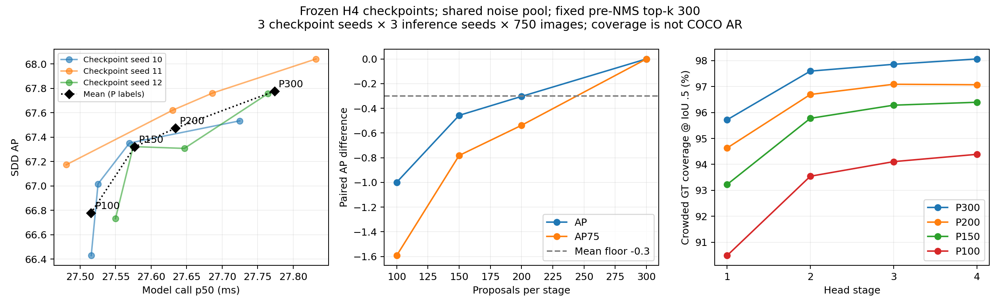
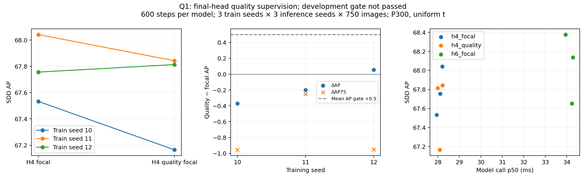
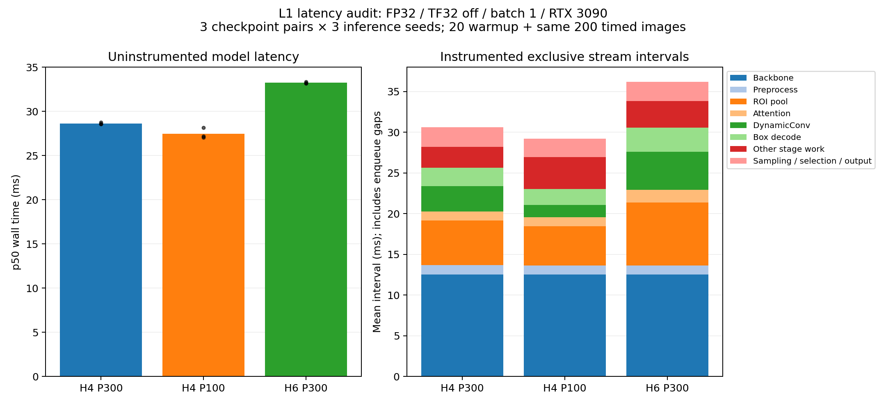
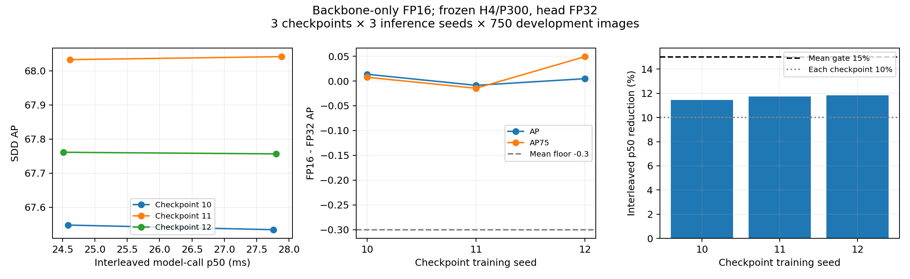
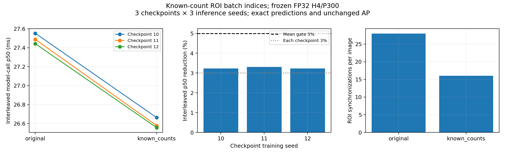

# V3 验证记录

更新：2026-10-15。G1/G2/T1/P1/Q1/L1/B1/R1均已完成；各节保留对应协议、结果和复现入口。

## G0：实现正确性

- `tests/test_v3_head.py`：4 passed。
- `tests/test_m1_ddim.py tests/test_m1_convergence.py`：11 passed。
- 覆盖提前退出实际跳层、前缀精确等价、训练保留全部层、注意力优化参数/梯度/数值兼容、旧采样器回归。
- GPU 冒烟：现存 SDD 权重严格加载，32 图、H6 legacy / H4 no_weights 都完成推理和 COCO 评测。
  子集不覆盖全部类别，**不将它的 AP 用于选型或宣传增益**。

## G1：冻结权重检测头扫描

主实验：`runs/v3/head_sweep_20261011/`，15/15 组完成，评测循环总耗时约 484 秒。
全部 AP 来自完整 750 图。3 个种子为推理噪声种子，不是训练重复。
使用短训 SDD bs8 ckpt，不能与历史 long ckpt 的 70.27 AP 比较。

### 协议与原始证据

- GPU1 / RTX 3090；torch 2.1.2+cu121，detectron2 0.6。
- 同一冻结 ckpt，NFE=1，P=300，FP32，TF32 关闭，输入短边 800/长边上限 1333。
- batch=1；每臂 20 图 warmup + 同一 200 图计时；CUDA 同步的模型调用 wall time。
  不含磁盘解码/CPU resize/evaluator，含模型内部预处理、H2D、backbone、检测头和后处理。
- 表中 AP 标准差为 3 个推理 seed 的 sample std（ddof=1）；延迟为各 seed 的 p50/p95 均值。
  Speedup 为按 seed 配对的 baseline p50 / arm p50 再求均值，不是批量吞吐实测。
- ckpt SHA256：`a79a15b0c3c2307fecd03d0d059c6fb24bb3c15786f3b9ceb6ffff59a4a9fc6f`。
- [逐次 CSV](../../results/raw/v3_head_sweep.csv)、[汇总 CSV](../../results/raw/v3_head_sweep_summary.csv)、
  [逐类 AP](../../results/raw/v3_head_sweep_per_class.csv)、[运行 manifest](../../results/raw/v3_head_sweep_manifest.json)、
  [数据审计](../../results/raw/v3_sdd_data_audit.json)。原始预测/配置在 run 目录。

### 结果

| H | Attention | AP (mean±sample std) | ΔAP paired | AP75 | p50 ms | p95 ms | Speedup |
|---|---|---|---|---|---|---|---|
| 6 | legacy | 66.540±0.117 | +0.000 | 72.301 | 34.64 | 37.60 | 1.000× |
| 6 | no_weights | 66.540±0.117 | +0.000 | 72.301 | 33.72 | 36.57 | 1.027× |
| 5 | no_weights | 66.200±0.055 | -0.340 | 71.912 | 30.77 | 33.38 | 1.126× |
| 4 | no_weights | 65.853±0.246 | -0.687 | 72.182 | 27.88 | 29.90 | 1.243× |
| 3 | no_weights | 64.622±0.184 | -1.918 | 71.394 | 24.95 | 27.09 | 1.388× |



### Gate 与设计更新

1. **G1 未通过，不能把 4 级头直接作为无损替代。** 4 级头平均 p50 降低约 19.5%，
   但 AP 配对下降 0.687（各 seed 为 −0.851 至 −0.566），超过 −0.3 门槛；
   速度也略低于预先设定的 20% 降延迟门槛。3 级更快，但精度缺口更大。
   5 级的 AP 均值下降 0.340，也未达到 −0.3 门槛。
2. **关闭 attention weights 的数值兼容性得到支持，独立加速证据较弱。**
   同 6 级逐 seed ΔAP 的绝对值均 <0.00001 AP；平均延迟略低，但配对增益随运行顺序有变化。
   不把约 2.7% 的平均加速认定为跨机器稳定收益。该优化继续保留为可选项，默认仍为 legacy。
3. **继续优先验证 H4 学生的精度补偿。** 与 H3 相比，H4 所需恢复 AP 更少。
   H4 至少补约 0.39 AP 才进入基线 −0.3 带，补约 0.69 才打平，补约 1.19 才达到基线 +0.5。
   当前没有训练证据证明这些目标能达到。
4. **不要盲目把所有框蒸馏自最后一层。** H4 的 AP50 比基线低约 1.02，AP75 仅低约 0.12；
   这提示应检查召回、分类/排序和不同 IoU 阈值误差，而非直接假定纯坐标回归能力不足。
   逐类差异也大：Powdery Mildew Fruit −3.120 AP，Blossom Blight −1.131，
   Gray Mold 反而 +1.230。下一步先做 GT 匹配的质量筛选蒸馏，重点检查退化类别。
5. 本原型保留全部 6 级参数以兼容权重，仅少执行后续计算；峰值 allocated 显存约 0.678 GB，
   **未观察到显存收益**。真正保存精简学生时再删除部署不使用的层。

### 下一步最小训练对照

固定相同 H4 学生初始化与预算，分别训练无 KD 和有质量筛选 KD；以同一 6 级教师作为参照。
先 200–500 iter 检查可训练性与各类方向，再至少 3 对完整训练 seed 判定。
分布回归、质量校准、proposal schedule 均按 BLUEPRINT 单独消融，当前尚未实现或运行。
**本轮结论是“压缩收益和精度缺口已量化”，不是“已经同时提升 AP 和速度”。**

复现汇总与图：

```bash
/home/huachenghao/.conda/envs/fastdiff/bin/python scripts/v3_summarize.py \
  runs/v3/head_sweep_20261011
```

## G2 初筛：四级学生质量筛选蒸馏（2026-10-11）

用户继续后，已完成独立冻结六级教师 → 真实四级学生的实现、26 项自动测试、
实际 SDD 权重裁剪输出对拍，以及 **3 对训练 seed × 每臂 200 步 × 每模型 3 次全量评测**。
共 6 个训练模型、18 次 750 图评测。详细损失与配对协议见 [DISTILLATION.md](DISTILLATION.md)。
这是从同一 SDD checkpoint 继续微调的短预算筛选，每臂仅 1600 图次，不能解释为从头训练结果。

### 配对结果

每个训练 seed 的 AP 先对 3 个推理 seed 求平均，再求下面的配对差值。

| Training seed | Control AP | KD AP | Paired ΔAP | ΔAP50 | ΔAP75 |
|---|---|---|---|---|---|
| 10 | 66.444 | 66.195 | -0.249 | -0.351 | -0.899 |
| 11 | 66.707 | 66.108 | -0.599 | -0.069 | -0.787 |
| 12 | 65.287 | 66.484 | +1.198 | +0.502 | +1.394 |
| Mean | 66.146 | 66.263 | +0.117 | +0.027 | -0.097 |

配对 ΔAP 的 sample std = **0.952 AP**。Control/KD 的训练 seed 均值标准差分别为
0.756/0.197 AP；只有 3 对，不能据此认定 KD 稳定地降低了训练方差。



### 部署与训练成本

| 项 | Control | KD |
|---|---|---|
| 部署结构 | 真四级 | 真四级；教师不部署 |
| 参数量 | 83,077,868 | 83,077,868 |
| 评测 p50 均值 | 27.81 ms | 27.91 ms |
| 评测 p95 均值 | 29.99 ms | 29.90 ms |
| 推理 peak allocated | 0.578 GB | 0.577 GB |
| 每臂训练耗时均值 | 138.54 s | 183.05 s |
| 训练 peak allocated 均值 | 7.26 GB | 12.08 GB |

原六级为 110,560,770 参数、G1 p50=34.64 ms。四级参数少约 **24.9%**，本轮部署延迟约
减少 **19.4–19.7%**，推理 allocated 显存约少 **14.8%**。KD 比 Control 训练耗时多约 **32.1%**，
这些训练成本包含被冻结教师的前向；不是免费的增强。

### 正确性与诊断证据

- 三对初始学生 state digest、逐步训练输入/增强 digest、图次数均相同。
- 三个教师起止 state digest 不变，梯度全部为 None；没有迁移初始化静默缺失。
- 每批平均约 45.88 个 KD 配对，约占学生正匹配的 66.5%；合格教师/学生平均 IoU=0.9394/0.9170。
  KD 不是因为完全无正样本而失效；也不能把这样小的平均定位差当作必然有效的监督。
- KD 最后 20 步平均加权分类/框损失为 0.0502/0.1516；额外损失实际参与反向。
- 逐类 KD−Control：Blossom Blight +1.540，Powdery Mildew Leaf +0.578，
  Powdery Mildew Fruit +0.338；Angular Leafspot −0.668、Anthracnose Fruit Rot −0.670，
  Gray Mold −0.217、Leaf Spot −0.085。收益不是普遍提升。

### 判定和后续优先级

**G2 初筛：证据不足，不晋级为默认模型。** 平均增益 +0.117 低于预设 +0.5 AP，
且 3 对中有 2 对下降。KD 相对旧六级均值低 0.278，名义进入 −0.3 AP 带，
但这不能替代 KD 相对同预算 Control 的收益判定，也没有达到联合速度门槛。
本轮没有证明“蒸馏稳定增强精度”。

保留真实四级结构、严格加载、配对训练和可选 KD 的实现。下一阶段优先：

1. **先稳定学生微调**：比较更长的固定微调预算与当前 200 步预算，仍用配对训练 seed，
   避免把近一个 epoch 的数据顺序波动误判为架构效果。需要对比六级同预算控制。
2. **再分离训练时刻对齐因子**：在四级学生上单独比较 uniform 与 mix_tmax，检查
   训练监督是否与单步 t=999 的部署目标对齐。保持 KD 关闭作为明确控制；旧 V1 只提供方向线索。
3. 若继续 KD，先分解分类/框 KD，并记录教师置信度与按 t 分桶的覆盖率。
   当前联合损失不直接扩大预算，也不因为 seed12 的好结果选择性宣布通过。
4. 分布回归和 proposal schedule 仍为后续独立改造，尚未实现。

### 可复现实验产物

- [18 次评测 CSV](../../results/raw/v3_kd_pilot.csv)
- [三对训练差值](../../results/raw/v3_kd_pilot_paired.csv)
- [训练成本与校验摘要](../../results/raw/v3_kd_pilot_training.csv)
- [逐类 AP](../../results/raw/v3_kd_pilot_per_class.csv)
- [manifest](../../results/raw/v3_kd_pilot_manifest.json) 与 [实际配置](../../results/raw/v3_kd_pilot_config.yaml)
- [物理裁剪对拍](../../results/raw/v3_student_export_check.json)
- 原始模型/输入轨迹/预测/源码快照：`runs/v3/kd_pilot_20261011/`。
  所有最终 checkpoint 均保留，不按开发集结果挑选单一“最佳 seed”作为整体结论。

```bash
/home/huachenghao/.conda/envs/fastdiff/bin/python scripts/v3_summarize_distill.py \
  runs/v3/kd_pilot_20261011
```

## G1 冻结预测的误差补充诊断

在 T1 训练期间离线分析原 G1 的 H4/H6 no_weights、各3个推理 seed；未重训，
未使用真实标注改变模型分数。固定分析分数阈值0.05/0.3/0.5，不挑选部署阈值。
同类别 IoU≥0.5 按分数贪心一对一匹配；剩余框按重复、错分类、定位、背景依次归类。
这里的覆盖率允许多个GT共享一个预测，**不是COCO AR**；错误数量也不是TIDE的AP归因。

score≥0.3，每750图的3推理seed均值：

| 后处理结果 | H4 | H6 |
|---|---:|---:|
| 保留检测框 | 1800.33 | 1767.33 |
| 正确一对一匹配 | 1488.67 | 1483.33 |
| 重复框 | 5.00 | 3.67 |
| 错分类（与任意GT IoU≥0.5，正确类别未达0.5） | 20.33 | 19.67 |
| 定位偏差（同类别 IoU∈[0.1,0.5)） | 101.00 | 101.00 |
| 背景/其他低重叠框 | 185.33 | 159.67 |
| 同类别GT覆盖率，IoU≥0.75 | 76.53% | 75.81% |

score≥0.05 时，H4/H6 分别保留8878.67/6881.67个框，IoU0.5覆盖率97.58%/97.26%。
score≥0.5 时，两者背景框41.33/40.33，覆盖率70.33%/71.23%。因此 H4 额外输出
主要集中在较低置信度区域；不能只依据 AP 下降就认定它缺少框定位能力。
按置信度分桶的平均同类别 IoU 曲线很接近；score≥0.3且同类别IoU≥0.1的框中，
score-IoU Spearman为0.522/0.515，未显示显著的整体质量排序恶化。

**对蓝图的约束：**先考虑区分中低分背景的质量/分类监督；更复杂的分布回归仍需
证明能改善高IoU定位。NMS后的重复框较少，不优先改NMS。以上是开发集描述性现象，
不能估计某个新分支会增加多少AP，也不能证明提前裁剪proposal安全；后者必须测早期头召回。

- [诊断CSV](../../results/raw/v3_error_audit_diagnostics.csv)、[分桶数据](../../results/raw/v3_error_audit_calibration.csv)
- [数据与源码哈希](../../results/raw/v3_error_audit_manifest.json)、[诊断图](../../results/figures/v3_error_audit.png)
- 复现：`python scripts/v3_error_audit.py --out-dir runs/v3/error_audit_new`。

## T1：600步训练时刻对齐（已完成，不晋级默认）

实验于2026-10-11完成，2026-10-12汇总。6个真实H4模型、18次全量评测均正常退出，
`COMPLETE.json` 存在。两臂均无KD，每臂600步×batch8；协议与门槛预先固定于
[TIME_ALIGNMENT.md](TIME_ALIGNMENT.md)。每个表格点先平均3个推理seed，再比较训练seed。

| 训练seed | Uniform AP | Mix tmax AP | 配对 ΔAP | 配对 ΔAP75 |
|---|---:|---:|---:|---:|
| 10 | 67.534 | 68.107 | +0.574 | +0.525 |
| 11 | 68.042 | 68.033 | −0.009 | −0.703 |
| 12 | 67.756 | 68.588 | +0.832 | −0.304 |
| **均值** | **67.777** | **68.243** | **+0.465** | **−0.160** |

配对ΔAP的训练seed样本SD=0.431；模型内推理seed已先平均，不能把18次评测视作18次训练。
两组训练seed均值AP的样本SD分别0.255/0.302；只有3对，而且共享同一预训练初始化，
不据此宣称普遍的稳定性提升。

| 指标 | Uniform | Mix tmax |
|---|---:|---:|
| AP50 | 88.909 | 88.848 |
| AP75 | 74.103 | 73.943 |
| p50 模型调用延迟，ms | 27.625 | 27.656 |
| p95 模型调用延迟，ms | 29.479 | 28.466 |
| 推理峰值 allocated，GiB | 0.578 | 0.577 |
| 每模型600步训练时间，s | 407.95 | 405.06 |
| 训练峰值 allocated，GiB | 7.260 | 7.259 |
| 实际 t=999 占比 | 0.160% | 50.153% |
| 实际 t 均值 | 501.00 | 750.76 |

**判定：T1 未通过完整筛选门槛。** ΔAP≥+0.3、2/3种子为正、p50增幅≤3%均满足；
但平均ΔAP75=−0.160，低于预设−0.1底线，且2/3种子的AP75下降。
不能因为总体AP增加而事后放宽定位门槛。保持uniform为默认训练分布，mix_tmax保留可选实验。
这项训练改动没有减少部署计算；观察到的p50差异仅+0.11%，不能当作新增提速。

逐类收益并不均匀：Blossom Blight +1.931、Powdery Mildew Leaf +0.734、Angular Leafspot +0.725；
Anthracnose Fruit Rot −0.210、Powdery Mildew Fruit −0.109、Leaf Spot −0.085。
不能把提升解释为所有类别、所有定位阈值都获益；small目标仅12个，APs不作为主要依据。

### 已获得的实际速度—精度候选

| 配置 | AP | p50，ms | 额外微调 |
|---|---:|---:|---|
| G1 原六级 legacy 冻结参考 | 66.540 | 34.640 | 无 |
| G1 冻结权重四级出口 | 65.853 | 27.882 | 无 |
| T1 真实四级、uniform | 67.777 | 27.625 | 600步 |
| T1 真实四级、mix_tmax | 68.243 | 27.656 | 600步 |

600步uniform H4 相对原六级冻结参考，观察到AP高1.237、p50低约20.25%，参数少24.9%。
这是**裁剪、执行优化及额外微调的组合结果**，T1当时未设置同预算六级训练臂，不能把全部AP增益
归因于压缩，也不能据此宣布完整架构门槛已获独立确认。同预算对照现已补齐，见下方Q1。

相比G2的200步无KD控制均值66.146，本轮600步uniform均值67.777，高约1.631 AP。
三组seed前200步的增强图像/GT哈希各200/200一致，但LR衰减点从160移到480，
因此这是预算与学习率日程的共同变化，不能称为只增加步数的严格单因子实验。
它支持优先保留足够微调预算，再验证复杂损失的附加价值。

### 审计与后续蓝图

- 3对初始化、增强输入、x_start/填充框、eps、base t、私有gate、forward后全局RNG均一致。
- 逐图实际t符合配置；6份checkpoint、12份源码快照哈希核验通过；配对配置仅t分布/输出目录不同，
  逐步LR完全相同，日志无KD损失。47项测试通过。任务exit code 0，结束后GPU1显存0 MiB。
- 保留全部6份最终模型；未依据开发集挑选单一“最佳seed”，未将小数点附近的AP75失败改判为通过。
- 当时下一优先级为 **同预算H6对照**和独立背景/定位质量监督，现已由Q1完成。
  暂不搜索更多mix概率。分布回归与逐级proposal裁剪仍未实现，需各自的隔离实验与召回审计。

产物：
[18次评测](../../results/raw/v3_time_alignment.csv) ·
[配对汇总](../../results/raw/v3_time_alignment_paired.csv) ·
[训练审计](../../results/raw/v3_time_alignment_training.csv) ·
[逐类AP](../../results/raw/v3_time_alignment_per_class.csv) ·
[门槛判定](../../results/raw/v3_time_alignment_gate.json) ·
[manifest](../../results/raw/v3_time_alignment_manifest.json) ·
[配置](../../results/raw/v3_time_alignment_config.yaml) ·
[图](../../results/figures/v3_time_alignment.png)。
原始权重、预测、逐步日志及源码快照：`runs/v3/time_alignment_20261011/`。

```bash
/home/huachenghao/.conda/envs/fastdiff/bin/python scripts/v3_summarize_time_alignment.py \
  runs/v3/time_alignment_20261011
```

## P1：固定候选框预算（2026-10-13完成，保留P300）

接续上次32图冒烟，本轮完成三份T1 uniform H4权重 × 四种P × 三个推理seed，
共36次750图全量评测。权重全部冻结，固定共享300框高斯噪声池的前缀，
pre-NMS top-k恒为300；协议和门槛预先固定于[PROPOSAL_BUDGET.md](PROPOSAL_BUDGET.md)。
这衡量已训练H4模型的预算敏感性，未训练小P模型，也未实现逐级剪框。

| 每级P | AP | 配对ΔAP | AP75 | 配对ΔAP75 | p50 ms | p95 ms | p50降幅 |
|---|---:|---:|---:|---:|---:|---:|---:|
| 300 | 67.777 | +0.000 | 74.103 | +0.000 | 27.774 | 28.693 | 0.00% |
| 200 | 67.474 | −0.303 | 73.566 | −0.538 | 27.634 | 28.646 | 0.50% |
| 150 | 67.320 | −0.457 | 73.321 | −0.782 | 27.577 | 28.511 | 0.71% |
| 100 | 66.778 | −0.999 | 72.510 | −1.593 | 27.515 | 28.587 | 0.93% |

每个checkpoint先平均三个推理seed，再跨三份checkpoint等权平均。
p50降幅先计算checkpoint内的均值比率，再取均值。计时包含完整噪声池生成与模型调用，
FP32、TF32关闭、batch1、20图预热+同200图CUDA同步测量。
本轮P300的AP与T1逐个seed、逐个AP指标完全一致；延迟为本轮重新测量，
与T1旧记录27.625ms的微小差异不归因于模型变化。



### 覆盖率和类别否决条件

| 每级P | 最后一级全GT覆盖IoU0.5 | 拥挤图覆盖IoU0.5 | 拥挤图Δ覆盖（百分点） | 最差类别ΔAP |
|---|---:|---:|---:|---|
| 300 | 99.130% | 98.067% | +0.000 | 基准 |
| 200 | 98.660% | 97.072% | −0.995 | Anthracnose Fruit Rot −0.739 |
| 150 | 98.260% | 96.396% | −1.670 | Angular Leafspot −0.849 |
| 100 | 97.327% | 94.388% | −3.679 | Powdery Mildew Fruit −1.692 |

全验证集1775个GT，拥挤图（每图≥5个目标）含592个GT。覆盖率是NMS前每个GT的
最佳类别无关IoU，允许一个框覆盖多个GT，**不是COCO AR**。
各类别平均AP下降均未超过2.0，但P150/P100拥挤图覆盖率下降超过1个百分点。
早期头的覆盖差距在后续头中没有完全恢复；“目标不多”并不能证明小P足够。

### 判定与后续方向

**P1三个候选全部未通过，保持P300。** P200的实际平均ΔAP=−0.303468，略低于−0.3；
同时AP75下降0.538、p50降幅远低于10%，不因AP接近边界而放宽门槛。
P150/P100的AP、AP75、速度和拥挤覆盖率门槛均未满足。所有候选的速度改进都不足1%，
不能将其表述为实用加速，更不能宣称通过G4的1.4倍目标。

这否定的是当前冻结H4权重、RTX3090、FP32协议下的直接固定减框方案，
不等于证明小P重训或其他部署后端无效。未做分段耗时分析，不能由这张表直接判定
瓶颈来自CPU、backbone或某个算子。逐级剪框在投入训练前应先证实实际可节省的延迟。
随后由Q1完成同预算H6对照与独立质量监督；不继续用开发集搜索更多固定P值。

### 审计和复现

- 36行评测、1296行逐级/逐类覆盖率完整，无重复或非有限AP。
- 九组P300与T1所有AP指标最大偏差0；三份权重各两张真实图的注入噪声推理逐bit一致。
- 三份checkpoint、源码快照和原始/评测标注核验通过；覆盖GT分母与原始标注一致。
- 73项自动测试通过；主进程exit code 0、`COMPLETE.json`存在，GPU1结束后0 MiB。
- 未覆盖历史权重；运行与预测保存在`runs/v3/proposal_sweep_20261013/`。

产物：
[36次评测](../../results/raw/v3_proposal_sweep.csv) ·
[配对汇总](../../results/raw/v3_proposal_sweep_paired.csv) ·
[总体汇总](../../results/raw/v3_proposal_sweep_summary.csv) ·
[逐类AP](../../results/raw/v3_proposal_sweep_per_class.csv) ·
[逐级覆盖率](../../results/raw/v3_proposal_sweep_coverage.csv) ·
[Gate与审计](../../results/raw/v3_proposal_sweep_gate.json) ·
[manifest](../../results/raw/v3_proposal_sweep_manifest.json) ·
[配置](../../results/raw/v3_proposal_sweep_config.yaml) ·
[逐bit对拍](../../results/raw/v3_proposal_sweep_parity.json)。

```bash
/home/huachenghao/.conda/envs/fastdiff/bin/python scripts/v3_summarize_proposals.py \
  runs/v3/proposal_sweep_20261013
```

## Q1：最后一级质量监督与同预算H6（已完成，2026-10-14汇总）

**质量损失未通过预设门槛，保持原focal。** H4 quality相对H4 focal的平均AP下降0.170、
AP75下降0.720，只有1/3训练配对的AP上升。另行补齐的600步H6控制说明，
H4相对同预算H6少0.278 AP、p50低17.76%；尚未达到联合速度—精度目标。

本轮6个新模型各600步、3个复用控制、27次750图评测均完成，协议预先固定于
[QUALITY_SUPERVISION.md](QUALITY_SUPERVISION.md)。新H4 quality与H6 focal均从原短训H6
权重初始化；H4 focal复用T1 uniform末步模型并重新评测。每臂预算均为600步×batch8，
优化器/学习率/输入/噪声/t均配对，uniform、P300、NFE1、FP32、TF32关闭、无KD/EMA/AMP。
仅H4 quality的最后一级分类损失改为带原alpha权重的quality focal；辅助头仍用原focal，
Dynamic-K匹配算法及代价、L1/GIoU和推理结构不变。它不是完整GFL或分布回归的复现。

### 质量监督配对结果与门槛

每份最终模型先平均推理seed0/1/2，再按训练seed10/11/12配对；27次评测不代表27次训练。

| 训练seed | H4 focal AP | H4 quality AP | Q1 ΔAP | Q1 ΔAP75 | H6 focal AP | H4−H6 AP |
|---|---:|---:|---:|---:|---:|---:|
| 10 | 67.534 | 67.165 | −0.369 | −0.955 | 68.136 | −0.603 |
| 11 | 68.042 | 67.843 | −0.199 | −0.253 | 67.653 | +0.389 |
| 12 | 67.756 | 67.813 | +0.057 | −0.952 | 68.377 | −0.621 |
| **均值** | **67.777** | **67.607** | **−0.170** | **−0.720** | **68.056** | **−0.278** |

Q1配对ΔAP的训练seed样本SD为0.214；H4 focal/quality的训练seed均值AP样本SD为0.255/0.383。
三份模型共享同一预训练初始化，不能据此宣称普遍训练稳定性；所有最终模型均保留。

| Q1预设条件 | 结果 | 判定 |
|---|---:|---|
| 平均ΔAP≥+0.5 | −0.170 | 未通过 |
| 平均ΔAP75>0 | −0.720；3/3配对下降 | 未通过 |
| 至少2/3配对AP为正 | 1/3 | 未通过 |
| p50增幅≤5% | +0.037% | 通过 |
| 最差类别平均ΔAP≥−2 | Anthracnose Fruit Rot −0.633 | 通过 |

逐类quality−focal：Blossom Blight +0.494、Powdery Mildew Leaf +0.074；
Anthracnose Fruit Rot −0.633、Powdery Mildew Fruit −0.548、Angular Leafspot −0.277、
Gray Mold −0.159、Leaf Spot −0.143。未出现超过2 AP的类别否决，但总体和高IoU精度仍下降。
不因seed12微幅上升而选择该seed，也不修改门槛或搜索alpha/gamma以改变本轮判定。



### 独立同预算深度比较与成本

| 指标 | H4 focal | H4 quality | H6 focal |
|---|---:|---:|---:|
| AP | 67.777 | 67.607 | 68.056 |
| AP50 | 88.909 | 88.689 | 89.142 |
| AP75 | 74.103 | 73.383 | 73.850 |
| p50模型调用，ms | 28.087 | 28.097 | 34.152 |
| p95模型调用，ms | 29.216 | 28.904 | 35.571 |
| 参数量 | 83,077,868 | 83,077,868 | 110,560,770 |
| 推理峰值allocated，GiB | 0.580 | 0.582 | 0.684 |
| 每模型600步训练时间，s | 407.95（T1原记录） | 412.41 | 502.54 |
| 训练峰值allocated，GiB | 7.260（T1原记录） | 7.260 | 8.803 |

延迟均在本轮GPU1重新测量：batch1、20图预热+同200图CUDA同步计时，口径沿用G1。
p50相对变化先在每个训练seed内计算比率再平均。H4 quality没有新增部署计算，
相对H4 focal的+0.037%不能解释为结构性变化；H4与T1旧计时的微差也不归因于模型变化。
H4 focal训练时间复用历史记录，因此表中训练时间只作成本记录，不据约1%的差异断言QFL开销。

相同600步预算下，原focal的H4−H6为**−0.278 AP、+0.253 AP75，p50降低17.76%**，
H4参数少24.9%。AP均值名义进入−0.3带，但配对ΔAP样本SD为0.578，2/3配对AP下降，
且速度不足20%，不能称为已确认的无损压缩或满足G5联合目标。
逐类差异也明显：Blossom Blight −1.653、Powdery Mildew Fruit −0.986、Angular Leafspot −0.931；
Gray Mold +0.822、Anthracnose Fruit Rot +0.768。不能把平均差值推广到每个类别。
这个比较同时包含头深度与辅助监督数量变化，不分离二者贡献，也不计作quality focal的收益。

### 固定阈值诊断：背景减少伴随覆盖损失

沿用G1固定阈值0.05/0.3/0.5，不重新选阈值。以下为score≥0.3、每750图的
三训练seed×三推理seed均值；匹配与错误类别沿用G1的同类别IoU0.5贪心一对一规则。

| 后处理结果 | H4 focal | H4 quality | H6 focal |
|---|---:|---:|---:|
| 保留检测框 | 1886.00 | 1778.78 | 1873.11 |
| 正确一对一匹配 | 1537.56 | 1499.56 | 1533.89 |
| 背景/低重叠框 | 202.67 | 161.67 | 187.89 |
| 定位偏差 | 119.89 | 98.56 | 126.56 |
| 错分类 | 21.44 | 16.22 | 18.56 |
| 重复框 | 4.44 | 2.78 | 6.22 |
| 同类别GT覆盖率IoU≥0.5 | 86.692% | 84.532% | 86.523% |
| 同类别GT覆盖率IoU≥0.75 | 79.299% | 77.546% | 78.773% |

quality相对focal每750图平均少41个背景框，也少38个正确匹配、IoU0.75覆盖率少1.75个百分点。
在阈值0.05和0.5下，quality的正确匹配与覆盖率也更低。阈值0.3、同类别IoU≥0.1的预测中，
score-IoU Spearman为0.543/0.546，未显示明显排序改善。训练最后20步平均正匹配IoU为0.929，
确认质量目标实际存在，不能将失败解释为从未得到质量监督。

这些计数受分数分布影响；GT覆盖率允许多个GT共享预测，**不是COCO AR或TIDE的AP归因**。
它们支持“背景抑制同时损失覆盖”的描述，不能据此证明AP下降的唯一原因，
也不能将本轮最终分类损失的结果外推为分布回归或所有质量分支均无效。

### 审计、后续约束和产物

- 六个新训练日志各600步完整；逐步输入/GT、填充框/eps、t、私有gate、forward后全局RNG和LR均与T1配对。
- 三次原初始化H4首批损失重放通过；新H4及H6前四级初始化digest与T1一致。
- 九组H4 focal重新评测的所有总体/逐类AP与T1完全一致，最大偏差0；延迟全部重新测量。
- 九份最终模型、原初始化权重、源码快照、参考日志、配置和标注SHA256核验通过；运行时协议快照保留。
- 83项完整测试及18项新增汇总审计测试通过，累计101项；覆盖质量目标/梯度边界、二值focal等价、
  空GT、仅最终头生效、控制复用、完整评测矩阵、逐步配对和每项门槛否决。
- 训练与两份报告脚本均exit code 0，`COMPLETE.json`存在；结束后GPU1显存0 MiB，其他GPU未干预。

保持uniform、P300和原focal；同预算H6缺口已补齐。后续若重启提速方向，先做分段耗时分析，
确认可节省的成本再改结构；若试分布回归，先检查训练集残差覆盖范围并单独消融。
当前SDD验证集已反复用于开发，以上均不是独立测试集确认，不直接推广为默认联合模型。

产物：
[27次评测](../../results/raw/v3_quality.csv) ·
[配对汇总](../../results/raw/v3_quality_paired.csv) ·
[逐类AP](../../results/raw/v3_quality_per_class.csv) ·
[训练审计与成本](../../results/raw/v3_quality_training.csv) ·
[Gate与深度比较](../../results/raw/v3_quality_gate.json) ·
[manifest](../../results/raw/v3_quality_manifest.json) ·
[实际配置](../../results/raw/v3_quality_config.yaml) ·
[首批控制重放](../../results/raw/v3_quality_control_replay.json) ·
[诊断计数](../../results/raw/v3_quality_diagnostics.csv) ·
[分数分桶](../../results/raw/v3_quality_calibration.csv) ·
[诊断数据与源码哈希](../../results/raw/v3_quality_diagnostics_manifest.json)。
原始权重、逐步日志、源码/参考快照和预测：`runs/v3/quality_20261013/`；
复用控制权重保留于`runs/v3/time_alignment_20261011/`，没有覆盖历史产物。

```bash
/home/huachenghao/.conda/envs/fastdiff/bin/python scripts/v3_summarize_quality.py \
  runs/v3/quality_20261013
/home/huachenghao/.conda/envs/fastdiff/bin/python scripts/v3_quality_diagnostics.py \
  runs/v3/quality_20261013
```

## L1：冻结模型的计算成本与同步诊断（2026-10-14完成）

**减框保留了大量逐级调用和同步，下一步优先独立验证骨干精度模式与ROI执行优化。**
本轮没有训练或修改生产模型；沿用三份T1 H4和三份Q1 H6原focal权重，
完成H4/P300、H4/P100、H6/P300 × 推理seed0/1/2，共27个计时单元。
协议运行前固定于[LATENCY_PROFILE.md](LATENCY_PROFILE.md)，所有臂都是GPU1、FP32、
TF32 off、NFE1、batch1、800/1333、共享300框噪声池、固定pre-NMS top-k300。
每单元前20图预热、随后同200图计时；这是成本诊断，**不计算子集AP**。

### 无插桩响应时间与波动

| 配置 | p50 ms | p95 ms | 均值 ms | event相对plain的p50变化 |
|---|---:|---:|---:|---:|
| H4/P300 | 28.645 | 30.236 | 28.651 | +6.59% |
| H4/P100 | 27.473 | 29.264 | 27.760 | +5.76% |
| H6/P300 | 33.238 | 34.748 | 33.434 | +8.21% |

分位数先逐单元计算，再平均推理seed和训练seed；相对变化先平均同checkpoint的推理seed，
再计算比率。plain是无包装的完整模型调用加噪声生成，包含前后CUDA同步，
不含读取/CPU resize/设置随机种子/输出校验。

| 训练seed | P100相对P300的p50降幅 | H4/P300相对H6/P300的p50降幅 |
|---|---:|---:|
| 10 | 2.05% | 13.41% |
| 11 | 5.37% | 13.72% |
| 12 | 4.87% | 14.32% |
| 均值 | 4.10% | 13.82% |

单个训练/推理seed配对的P100降幅范围为−10.17%至+12.50%，不把均值4.10%解释为
跨运行稳定收益。event−plain的单元变化范围分别为H4/P300的−3.15%至+19.21%、
H4/P100的−3.52%至+8.06%、H6的+7.54%至+8.91%。两遍固定先plain后event，
差值含插桩影响及时间漂移；负值不能解释为插桩优化了模型，也不能据此简单扣除开销。

本轮计时与P1（P100降幅0.93%）及Q1（H4相对H6降幅17.76%）不同，保留各自原始表格。
这些运行没有锁定CPU调度/GPU时钟；本轮不据微小差值作新模型晋级，也不改写P1/Q1的判定。
P100的已知AP损失仍以P1全验证为准，不能用L1的局部计时抵消它。



### 嵌套event区间：骨干与检测头都占主要成本

下表按逐图嵌套区间减去直接子区间后求均值，列出的组件互不重复。
event区间包含GPU执行与CPU供给间隙，**不是纯kernel时间**；只在整次调用末尾同步，
没有在每段之间人为添加同步。

| 区间均值，ms | H4/P300 | H4/P100 | H6/P300 |
|---|---:|---:|---:|
| 预处理/H2D | 1.153 | 1.131 | 1.124 |
| Backbone | 12.538 | 12.526 | 12.506 |
| ROI池化 | 5.475 | 4.818 | 7.750 |
| Attention | 1.122 | 1.081 | 1.548 |
| DynamicConv | 3.116 | 1.494 | 4.664 |
| 框解码 | 2.232 | 1.991 | 2.996 |
| 其余头部计算与调度 | 2.852 | 4.184 | 3.627 |
| 采样/选择/NMS/输出等余项 | 2.106 | 1.995 | 1.979 |
| 整次调用stream区间 | 30.594 | 29.220 | 36.195 |

H4/P300的backbone占约41.0%，完整head合计14.798ms、约48.4%；attention只占约3.7%。
P300→100使DynamicConv区间减少约1.622ms，ROI减少约0.657ms，但其余区间并未同比缩短。
更快的kernel会改变CPU提交与GPU队列等待的位置，不能将各段差值解释为完全独立的算子收益。
同样，H4/P300的ROI主机调用区间约10.333ms，高于它的stream区间5.475ms；
主机区间包含等待之前已提交GPU工作的时间，不能说ROI本身就消耗10ms纯CPU计算。

### 算子轨迹：P100没有减少同步或kernel启动次数

全部计时结束后才启动CUPTI profiler。每份checkpoint/臂固定推理seed0、计时窗口前10图，
共9条轨迹；对同步事件按同一主机线程的最内层用户区间和CPU算子归属。

| 每图轨迹统计 | H4/P300 | H4/P100 | H6/P300 |
|---|---:|---:|---:|
| CUDA kernel数 | 877.0 | 904.2 | 1136.7 |
| kernel活动区间并集，ms | 17.621 | 15.176 | 20.279 |
| ROI内stream同步 | 28 | 28 | 42 |
| 其中nonzero | 16 | 16 | 24 |
| 其中scalar读取（item/_local_scalar_dense） | 8 | 8 | 12 |
| 其中copy | 4 | 4 | 6 |

ROI每一级都有7次同步，减框没有删掉这些调用；其余预处理/选择/输出每图另有9次stream同步。
外层基准的device同步另列为outside_call，不计入ROI。框数变小后kernel启动总数甚至略增，
因此不能按理论P²复杂度推算总响应时间。轨迹中attention实际使用
`aten::_scaled_dot_product_efficient_attention`，不将其称为FlashAttention。

kernel并集按实际CUDA时间戳去重，避免跨stream重叠重复计数；profiler有明显扰动，
且只覆盖10图，不能将17.621ms与前表200图的plain或event时长直接相减来估算“纯CPU瓶颈”。
同步次数是机制证据，不是移除同步后的可实现加速预测。

### 后续执行方向与可复现产物

1. 单独比较骨干混合精度，其余路径维持FP32，并重新全量验证AP/AP75/逐类指标。
   骨干是较大的可干预成本，但尚未验证该精度模式能保持检测质量。
2. 独立验证使用CPU已知框数构造池化索引，减少动态长度/格式转换同步。
   先检查数值与梯度/输出等价，再测无插桩速度；按层nonzero等剩余开销另行评估。
   不修改安装依赖、不直接删除有效性检查，也不预先声称能达到10%或更高提速。

不继续搜索更多固定P值，不将L1解释为已经训练或实现了新加速模型。

## B1：仅骨干FP16推理（2026-10-15完成）

**精度保持，但交错计时p50仅降低11.66%，未达到预设15%门槛；保留FP32默认。**
FP16作为独立可选推理模式保留，未晋级为本轮开发部署候选，也没有产生新训练权重。

### 协议与可追踪证据

协议在结果前固定于[BACKBONE_PRECISION.md](BACKBONE_PRECISION.md)。使用T1的三份600步
uniform H4末步权重，P300、NFE1、原focal、no_weights、固定top-k300，保持输入尺寸与NMS。
FP32/骨干FP16各3个推理seed，共18次完整750图验证，仅使用GPU1 / RTX 3090。
只有backbone/FPN开启CUDA autocast，特征转回FP32后才进入检测头；参数与buffer不转换。

每次完整验证记录20图预热+200图同步模型调用计时。另外在相同图像、噪声seed上逐图AB/BA
交错两臂，共9组×2臂×200图，作为速度门槛依据。噪声生成、autocast及特征还原都计入耗时，
CPU读取/resize、随机种子设置、evaluator和数值审计不计入；计时阶段没有dtype hooks或profiler。
先在每份checkpoint内平均推理seed，再对三个checkpoint等权平均；速度降幅平均checkpoint比值。

- 正式目录：`runs/v3/backbone_precision_20261015/`；32图冒烟仅验证管线，不参与结论。
- [18次完整评测](../../results/raw/v3_backbone_precision.csv)、
  [交错计时](../../results/raw/v3_backbone_precision_interleaved.csv)、
  [checkpoint配对](../../results/raw/v3_backbone_precision_paired.csv)、
  [汇总](../../results/raw/v3_backbone_precision_summary.csv)、
  [逐类AP](../../results/raw/v3_backbone_precision_per_class.csv)。
- [manifest](../../results/raw/v3_backbone_precision_manifest.json)、
  [dtype/特征误差审计](../../results/raw/v3_backbone_precision_precision_audit.json)、
  [冻结状态审计](../../results/raw/v3_backbone_precision_state_audit.json)、
  [原始产物hash](../../results/raw/v3_backbone_precision_artifacts.json)、
  [Gate与证据审计](../../results/raw/v3_backbone_precision_gate.json)。
  大型预测及逐图计时记录保留在run目录。

### 精度与延迟

| 模式 | AP | AP75 | 交错p50 ms | 交错p95 ms | 峰值allocated GiB |
|---|---:|---:|---:|---:|---:|
| FP32 | 67.777 | 74.103 | 27.815 | 28.950 | 0.576 |
| 仅骨干FP16 | 67.780 | 74.117 | 24.570 | 25.958 | 0.597 |

| checkpoint训练seed | ΔAP | ΔAP75 | FP32 p50 ms | 骨干FP16 p50 ms | p50降低 | p95变化 |
|---|---:|---:|---:|---:|---:|---:|
| 10 | +0.014 | +0.008 | 27.761 | 24.583 | 11.45% | −11.07% |
| 11 | −0.009 | −0.015 | 27.884 | 24.614 | 11.73% | −10.05% |
| 12 | +0.005 | +0.049 | 27.799 | 24.514 | 11.82% | −9.88% |
| 均值 | +0.003 | +0.014 | 27.815 | 24.570 | 11.66% | −10.33% |

ΔAP跨checkpoint的sample SD为0.011；这些微小差异不构成训练或结构精度提升的证据。
最差类别为Blossom Blight，平均ΔAP−0.022；其他类别差值均在−0.004至+0.031之间。
完整验证中的顺序计时FP32/骨干FP16 p50为27.873/24.697ms、p95为28.781/26.147ms，
与交错结果方向一致；不把两套计时合并成额外独立重复。
FP16的峰值allocated显存略高，不能将该模式描述为显存优化；它包含临时半精度计算与FP32特征还原。



### 数值审计与Gate

九组FP32控制的总体/逐类AP与T1完全一致，最大绝对偏差0。18次验证共13,500次图像调用的
最终预测均有限；六张审计图的两臂共12条dtype记录确认stem卷积及FPN输出实际为FP16，
恢复后的head输入、四级head输出、最终框与分数均为FP32。FPN特征最大绝对误差0.02983，
最大相对L2误差0.001758；这只是数值诊断，不代替完整AP验证。

三份模型起止状态digest一致，且与源checkpoint内容一致。原checkpoint的453个FP32状态张量
和12个FP64扩散日程buffer保持原样；`all_float_state_fp32=false`来自原有FP64日程，
不是推理期间改变了权重精度。backbone/head浮点状态均为FP32。
完整矩阵、原始图像窗口、AB/BA次序、分位数、三份权重、17份源码快照、标注、T1参考记录和
81份预测/计时产物hash全部核验通过。正式进程和汇总均exit code 0，GPU1结束后0 MiB。
新增27项精度边界与结果审计测试通过，完整测试集141 passed。

| 预设条件 | 实测 | 判定 |
|---|---:|---|
| 平均ΔAP≥−0.3 | +0.003 | 通过 |
| 平均ΔAP75≥−0.3 | +0.014 | 通过 |
| 每份checkpoint平均ΔAP≥−0.5 | 最低−0.009 | 通过 |
| 最差类别平均ΔAP≥−1.0 | −0.022 | 通过 |
| 交错p50平均降低≥15% | 11.66% | **未通过** |
| 每份checkpoint交错p50降低≥10% | 最低11.45% | 通过 |
| 平均p95增幅≤5% | −10.33% | 通过 |

不降低15%门槛，不追加BF16/全模型AMP后改写本轮结果。保持uniform、P300、原focal与FP32默认。
后续优先独立验证ROI动态长度同步优化，先对拍数值和梯度，再测量无插桩端到端耗时。
本轮仍使用反复用于选型的SDD开发集，不能视为未参与选型数据上的确认。

### 复现入口

```bash
# 使用新的run目录；历史权重只读。
/home/huachenghao/.conda/envs/fastdiff/bin/python scripts/v3_backbone_precision.py \
  --gpu 1 --out-dir runs/v3/backbone_precision_new_run
/home/huachenghao/.conda/envs/fastdiff/bin/python scripts/v3_summarize_backbone_precision.py \
  runs/v3/backbone_precision_new_run --prefix v3_backbone_precision_new_run

# 可选推理配置：configs/lab/v3/sdd.res50.student4.backbone_fp16.yaml
# 默认仍是EVAL_BACKBONE_PRECISION=fp32；fp16仅适用于CUDA推理。
OMP_NUM_THREADS=4 /home/huachenghao/.conda/envs/fastdiff/bin/python -m pytest tests -q
```

## R1：ROI索引使用已知框数量（2026-10-15完成）

**预测逐bit一致、ROI同步减少，但交错p50仅降低3.26%，未达到预设5%门槛。**
保持原pooler默认；本地known-count pooler作为可选执行模式保留，没有修改安装的Detectron2。

### 协议与证据

协议在结果前固定于[ROI_KNOWN_COUNTS.md](ROI_KNOWN_COUNTS.md)。原路径将CPU已知的各图
框数量复制到GPU，用repeat_interleave构造batch索引。本轮使用Python shape数量直接创建
各图索引列，保留FPN层分配、逐层nonzero、ROIAlign、输出回填以及输入有效性检查。
不缓存特征，不改变框坐标、P300、H4或输入尺寸；不叠加B1骨干FP16。

使用T1三份600步uniform H4末步权重，原focal、no_weights、NFE1、全模型FP32，
训练seed10/11/12×推理seed0/1/2×两臂，共18次完整750图验证。仅GPU1 / RTX 3090。
完整验证内保留20图预热+200图同步模型调用计时；另外9组逐图AB/BA交错计时用于速度门槛。
全部计时完成后才启动三份权重×两臂×10图profiler，不使用profiler耗时评判速度。
先在checkpoint内平均推理seed，再等权平均checkpoint；速度降幅平均checkpoint比值。

- 正式目录：`runs/v3/roi_known_counts_20261015/`；32图冒烟仅验证实现和管线。
- [18次完整评测](../../results/raw/v3_roi_known_counts.csv)、
  [交错计时](../../results/raw/v3_roi_known_counts_interleaved.csv)、
  [checkpoint配对](../../results/raw/v3_roi_known_counts_paired.csv)、
  [汇总](../../results/raw/v3_roi_known_counts_summary.csv)、
  [逐类AP](../../results/raw/v3_roi_known_counts_per_class.csv)。
- [运行manifest](../../results/raw/v3_roi_known_counts_manifest.json)、
  [输出对拍](../../results/raw/v3_roi_known_counts_parity.json)、
  [CUDA梯度审计](../../results/raw/v3_roi_known_counts_gradient_audit.json)、
  [profiler计数](../../results/raw/v3_roi_known_counts_profiles.json)、
  [Gate及证据审计](../../results/raw/v3_roi_known_counts_gate.json)。
  大型预测、逐图时间与完整轨迹保留在run目录，
  [产物hash](../../results/raw/v3_roi_known_counts_artifacts.json)可核验。

### 结果

| pooler | AP | AP75 | 交错p50 ms | 交错p95 ms | ROI同步/图 | 峰值allocated GiB |
|---|---:|---:|---:|---:|---:|---:|
| 原实现 | 67.777 | 74.103 | 27.494 | 28.850 | 28 | 0.576 |
| 已知数量索引 | 67.777 | 74.103 | 26.598 | 27.883 | 16 | 0.576 |

| checkpoint训练seed | 原p50 ms | 新p50 ms | p50降低 | p95变化 |
|---|---:|---:|---:|---:|
| 10 | 27.552 | 26.662 | 3.23% | −2.99% |
| 11 | 27.488 | 26.578 | 3.31% | −3.47% |
| 12 | 27.442 | 26.556 | 3.23% | −3.60% |
| 均值 | 27.494 | 26.598 | 3.26% | −3.35% |

所有总体/逐类AP与T1一致，最大偏差0。完整验证内的顺序计时原/新p50为27.638/26.813ms，
p95为28.822/27.837ms，与交错结果方向一致；不合并成额外独立重复。
ROI同步次数减少42.86%，但模型调用p50只节省约0.896ms，不能按同步数量比例推断整体提速。



### 数值与机制审计

13项新pooler测试覆盖不等长batch、空图/空batch、单/多尺度、FPN边界、越界框、输入校验、
格式张量梯度和完整head的输出/参数梯度及checkpoint兼容；另有19项结果审计测试。
完整测试集173 passed。CUDA审计的池化输出精确一致；正式梯度最大绝对差0，
冒烟为7.45e-9，均在预设rtol/atol=2e-5范围内，没有因atomic累加而放宽门槛。

6,750对全验证图像的框、分数、类别digest完全一致，保存的COCO预测JSON也逐字节相同。
3,960次交错调用（含预热）与60次profiler调用均复现未插桩预测，全部预测有限。
三份模型的起止state digest一致，并与源checkpoint对应；旧权重只读。
21份源码快照、三份权重、原/过滤标注、T1参考与105份预测/计时/轨迹产物hash全部通过。
安装的Detectron2 poolers源码与快照hash一致。

六组profiler各观察到40次ROI调用：每10图原路径280次stream同步，新路径160次；
ROI域repeat_interleave算子记录由80条降至0条。减少的是索引构造所需的同步，
原逐层nonzero和ROIAlign仍在执行。profiler只证明调用/同步机制变化，不提供无插桩速度结论。

### Gate与后续

| 预设条件 | 实测 | 判定 |
|---|---:|---|
| 全验证预测精确一致、AP复现、有限性/状态/梯度/来源审计通过 | 全部通过 | 通过 |
| ROI repeat_interleave消失且同步减少 | 28→16次/图 | 通过 |
| 交错p50平均降低≥5% | 3.26% | **未通过** |
| 每份checkpoint交错p50降低≥3% | 最低3.23% | 通过 |
| 平均p95增幅≤5% | −3.35% | 通过 |

不下调5%门槛，不叠加FP16后改写本轮判定。默认保持原pooler、FP32、uniform、P300及原focal。
下一执行方向是保留下来的逐层nonzero动态长度路径；若采用固定容量或融合算子，必须单独
验证额外计算/内存开销、数值和梯度，再测量端到端收益。本轮没有实现该后续方案。
这些结果仅来自反复使用的SDD开发集和当前GPU，不能推广为其他硬件上的稳定加速。

### 复现入口

```bash
/home/huachenghao/.conda/envs/fastdiff/bin/python scripts/v3_roi_known_counts.py \
  --gpu 1 --out-dir runs/v3/roi_known_counts_new_run
/home/huachenghao/.conda/envs/fastdiff/bin/python scripts/v3_summarize_roi.py \
  runs/v3/roi_known_counts_new_run --prefix v3_roi_known_counts_new_run
# 可选配置：configs/lab/v3/sdd.res50.student4.roi_known_counts.yaml
# 默认ROI_POOLER_KNOWN_COUNTS=False；旧权重严格兼容。
```
六份权重、源码/配置/标注/外部pooler快照、逐图区间、分位数、执行H/P及9条轨迹哈希均通过审计。
5400次event与90次profiler输出对拍逐字节一致；13项新审计测试通过，
连同既有检测头/候选预算测试共26项通过。运行和汇总均exit code 0，GPU1结束后0 MiB。

产物：
[54份计时汇总](../../results/raw/v3_latency.csv) ·
[总体汇总](../../results/raw/v3_latency_summary.csv) ·
[训练seed配对](../../results/raw/v3_latency_paired.csv) ·
[嵌套区间](../../results/raw/v3_latency_scopes.csv) ·
[算子记录](../../results/raw/v3_latency_operators.csv) ·
[同步区间归属](../../results/raw/v3_latency_sync.csv) ·
[同步算子归属](../../results/raw/v3_latency_sync_operators.csv) ·
[轨迹摘要](../../results/raw/v3_latency_profiles.json) ·
[完整审计](../../results/raw/v3_latency_audit.json) ·
[manifest](../../results/raw/v3_latency_manifest.json) ·
[配置](../../results/raw/v3_latency_config.yaml)。
完整逐图记录、压缩Chrome trace和源码快照：`runs/v3/latency_20261014/`。

```bash
/home/huachenghao/.conda/envs/fastdiff/bin/python scripts/v3_summarize_latency.py \
  runs/v3/latency_20261014
```
